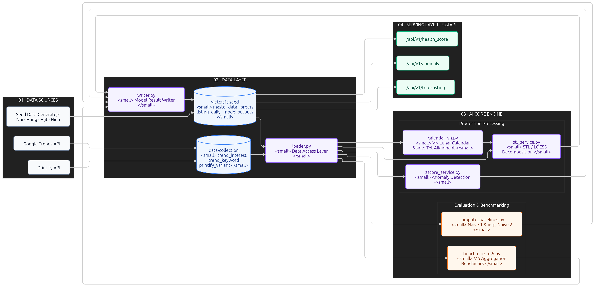

# VietCraft AI Analytics & Recommendation Engine

> **Hệ thống Phân tích Dữ liệu, Dự báo Mùa vụ & Gợi ý Thông minh — Sàn TMĐT VietCraft (SEP490)**  
> Trợ lý AI phân tích hành vi người dùng, dự báo xu hướng sản phẩm POD, phát hiện bất thường doanh số và đánh giá sức khỏe cửa hàng.

---

## 1. Kiến trúc Hệ thống (System Architecture)

Hệ thống được thiết kế theo kiến trúc **Clean Architecture**.



---

## 2. Luồng Dữ liệu (Data Flow)

### 2.1. Luồng Thu thập & Đồng bộ (Data Ingestion Pipeline)
1. **Google Trends & Printify**: Module `app/collectors/` thu thập chuỗi thời gian 5 năm (tuần) và 90 ngày (ngày) dựa trên bộ từ khóa trong `app/data/seed_keywords.json`, ghi vào database `data-collection`.
2. **Seed Data hợp nhất**: Script `app/seed/import_all_seeds.py` đọc các bảng dữ liệu sàn (Shops, Listings, Buyers, Orders, Listing Daily) và nạp dạng `upsert` vào database `vietcraft-seed`.

### 2.2. Luồng Xử lý AI & Dự báo (Analytics & Forecasting Flow)
1. **Nạp dữ liệu**: Mô hình gọi `loader.py` để lấy chuỗi thời gian chuẩn hóa có `DatetimeIndex` và tần suất cố định (`W-SUN` hoặc `D`).
2. **Xử lý đặc thù Tết Việt Nam**: `calendar_vn.py` tính toán trường `days_to_tet` để gom các đỉnh mùa vụ Tết Nguyên Đán (vốn lệch 4 tuần dương lịch qua các năm) về cùng một trục.
3. **Phân rã & Tính toán**: `stl_service.py` (sử dụng **STL Loess**) phân rã chuỗi thành `Trend`, `Seasonal`, `Residual` và chống nhiễu `robust=True`.
4. **Lưu kết quả**: Mô hình gọi `writer.py` để tự động đính kèm 3 trường metadata (`run_id`, `model_version`, `computed_at`) và ghi vào 6 collection kết quả (`forecast_point`, `seasonal_profile`, `anomaly_event`, `niche_score`, `listing_health`, `model_run`).

### 2.4. Luồng Mart — job tính đêm, API đọc ngày

```
ĐÊM:  app/core/build_marts.py  ->  đọc listing_daily / listings / reviews / trend_interest
                                ->  tính  ->  ghi 9 bảng mart
NGÀY: 16 endpoint F26–F41      ->  CHỈ đọc mart  ->  trả về (mục tiêu p95 < 500ms)
```

Endpoint **không bao giờ tính toán lúc gọi** — cần tính là thiết kế sai, đẩy về job.
Hợp đồng 9 mart (tên bảng, khoá, cột thân, cột bắt buộc) nằm trong
`app/core/writer.py` → `MART_SCHEMA`, **không phải trong file .md**: quy ước để
trong code thì máy ép đúng, không phụ thuộc ai có đọc tài liệu hay không.

```bash
.venv/bin/python -m app.core.build_marts --all --dry-run   # xem trước
.venv/bin/python -m app.core.build_marts --all             # dựng thật, ~3 phút
```

### 2.3. Luồng Phục vụ API (API Serving Flow)
- FastAPI đọc trực tiếp các bản ghi đã tính toán sẵn từ MongoDB `vietcraft-seed` thông qua các endpoint `/api/v1/` để phục vụ Frontend sàn TMĐT VietCraft.

---

## 3. Bố trí Thư mục Codebase (Directory Structure)

```text
AI-Analysic/
├── app/
│   ├── api/v1/               # 16 endpoint F26–F41, mỗi tính năng một file
│   │   ├── _template.py      # vỏ {data, meta, error} + xác thực — 16 endpoint dùng chung
│   │   ├── _mart.py          # lớp đọc MongoDB dùng chung
│   │   ├── analytics_routes.py # bảng 16 đường dẫn + đăng ký
│   │   └── f26_*.py … f41_*.py # mỗi tính năng một file, không ai đụng của ai
│   ├── collectors/           # Bộ crawler Google Trends & Printify API
│   ├── core/                 # Tầng logic lõi AI & Abstraction I/O
│   │   ├── build_marts.py    # [JOB ĐÊM] tính sẵn 9 bảng mart cho 16 endpoint đọc
│   │   ├── benchmark_m5.py   # Thử nghiệm mức độ gộp chuỗi M5 (Item/Group/Category)
│   │   ├── calendar_vn.py    # Xử lý lịch Tết âm lịch & đổi trục days_to_tet
│   │   ├── compute_baselines.py # Tính sai số mốc Naive cho 40 từ khóa Trends
│   │   ├── init_seed_db.py   # Khởi tạo 6 collections & indexes trên MongoDB
│   │   ├── loader.py         # Data Access Layer dùng chung cho toàn bộ AI
│   │   ├── verify_trends_freq.py # Kiểm tra tần suất chuỗi W-SUN & tính liên tục
│   │   └── writer.py         # Ghi kết quả model chuẩn hóa (Upsert idempotent)
│   ├── data/                 # [TẬP TRUNG] Dữ liệu tĩnh & mốc benchmark (.json)
│   │   ├── baselines.json    # Sai số baseline Naive 1 & Naive 2 của 40 từ khóa
│   │   └── seed_keywords.json# Bộ 44 từ khóa hạt giống & 1 từ khóa mốc (anchor)
│   ├── seed/                 # Script sinh dữ liệu seed (catalog, behavior, marketplace)
│   ├── services/             # Mô hình thống kê & thuật toán AI (STL Loess, Z-score)
│   ├── config.py             # Single Source of Truth Cấu hình (Load .env & app/data/*.json)
│   ├── main.py               # Thư mục khởi chạy ứng dụng FastAPI
│   └── .env                  # File biến môi trường bảo mật (Không commit)
├── scripts/
│   ├── peek.py               # xem nhanh một bảng trên MongoDB
│   └── validate_mart.py      # kiểm 9 mart có đúng MART_SCHEMA không
├── tests/
│   └── test_api_contract.py  # 12 test giữ 16 endpoint không trôi khỏi hợp đồng
├── docs/                     # Tài liệu & Báo cáo QC nghiệm thu
│   ├── API_CONTRACT.md       # hợp đồng 16 endpoint — nguồn duy nhất
│   ├── ADR-002.md            # quyết định LSTM cho F37 (ĐANG MỞ)
│   ├── architecture/         # Tài liệu kiến trúc sơ đồ database
│   └── qc/                   # Báo cáo kiểm định chất lượng (M5, Trends, Integration)
├── requirements.txt          # Danh sách thư viện Python có ghim phiên bản
└── README.md
```

---

## 4. Hướng dẫn Cài đặt & Setup Repo (Quick Start)

### 4.1. Phụ thuộc Yêu cầu
- Python **3.10** hoặc **3.12**
- Git & Virtualenv

### 4.2. Các bước Cài đặt
```bash
# 1. Clone repository
git clone https://github.com/.../AI-Analysic.git
cd AI-Analysic

# 2. Tạo môi trường ảo Python
python3 -m venv .venv
source .venv/bin/activate  # Trên Linux/macOS
# .venv\Scripts\activate   # Trên Windows

# 3. Cập nhật pip & cài đặt thư viện
pip install --upgrade pip setuptools wheel
pip install -r requirements.txt
```

---

## 5. Hướng dẫn Cấu hình File `.env` (.env Setup)

Tạo file `.env` tại vị trí **`AI-Analysic/app/.env`** (hoặc thư mục gốc `AI-Analysic/.env`).

### Lấy mẫu từ `.env.example`

```bash
cp .env.example .env      # rồi mở ra điền MONGODB_URI
```

`.env.example` là **nguồn duy nhất** liệt kê đầy đủ biến môi trường, kèm giá trị
mặc định và biến nào bắt buộc. Thêm biến mới thì cập nhật file đó, đừng chép lại
danh sách ra chỗ khác.

> [!WARNING]
> File `.env` chứa mật khẩu database và API tokens bảo mật, **tuyệt đối KHÔNG commit file `.env` lên GitHub**. File này đã được thêm sẵn vào `.gitignore`.

---

## 6. Quy chuẩn Đóng góp Mã nguồn (Contribution Guidelines)

1. **Không tạo abstraction dư thừa**: Viết mã nguồn ngắn gọn, trực diện, không tạo class bọc nhiều lớp khi không cần thiết.
2. **Không tự viết truy vấn DB riêng trong mô hình AI**: Tất cả các mô hình AI bắt buộc đọc dữ liệu qua `app/core/loader.py` và lưu kết quả qua `app/core/writer.py`.
3. **Mọi module phải có Self-Check**: Mỗi file Python tạo mới phải có khối `if __name__ == "__main__":` thực hiện tự kiểm tra logic độc lập không phụ thuộc test framework.
4. **Cách thêm từ khóa theo dõi mới**: 
   - Thêm vào file [app/data/seed_keywords.json](file:///home/rio/Documents/CODE/nodejs/vc-ai/AI-Analysic/app/data/seed_keywords.json) dạng:
     `{"keyword": "áo mới", "product_type": "tshirt", "topic": "evergreen"}`.

---

## 7. Lệnh Kiểm thử & Nghiệm thu (Verification Commands)

Đứng ở thư mục `AI-Analysic/` (không phải `AI-Analysic/app/`).

### 7.1. Khởi chạy server

```bash
source .venv/bin/activate
uvicorn app.main:app --reload            # -> http://localhost:8000/docs
```

**Cả 16 endpoint F26–F41 đều trả dữ liệu thật** (14/16 dưới 500ms) — với điều kiện
mart đã được dựng (`build_marts --all`). Bảng nghiệm thu từng endpoint kèm số đo:
[USAGE.md mục 8.3](USAGE.md#83-verify-16-endpoint-phân-tích-f26f41).

Không cần MongoDB để khởi động. **Mọi endpoint sẽ trả `401` cho tới khi SPEC-04
(JWT) xong** — chạy thử thì bật cửa hậu dev:

```bash
DEV_SHOP_ID=shp_00017 uvicorn app.main:app --reload
```

### 7.2. Kiểm nhanh, không cần MongoDB

```bash
.venv/bin/python tests/test_api_contract.py             # 11 test khung API
.venv/bin/python scripts/validate_mart.py --all --offline
```

### 7.3. Kiểm đầy đủ, cần MongoDB

```bash
.venv/bin/python app/core/loader.py \
  && .venv/bin/python app/core/writer.py \
  && .venv/bin/python app/core/calendar_vn.py \
  && .venv/bin/python app/services/stl_service.py \
  && .venv/bin/python app/core/benchmark_m5.py \
  && .venv/bin/python app/core/compute_baselines.py \
  && .venv/bin/python app/core/verify_trends_freq.py

.venv/bin/python app/core/init_seed_db.py                    # 6 bảng + index
.venv/bin/python app/seed/verify_integration_5_members.py    # liên kết chéo 5 người
.venv/bin/python scripts/validate_mart.py --all --sample 100 # dữ liệu mart (CHỈ ĐỌC)

# Dựng lại toàn bộ 9 mart (~3 phút) — GHI lên Atlas dùng chung, xem cảnh báo ở USAGE.md 9.3
.venv/bin/python -m app.core.build_marts --all
```

> 📌 **Chi tiết toàn bộ quy trình kiểm thử và kết quả kỳ vọng (Expected Outputs)**: Xem tại file [USAGE.md](USAGE.md).
