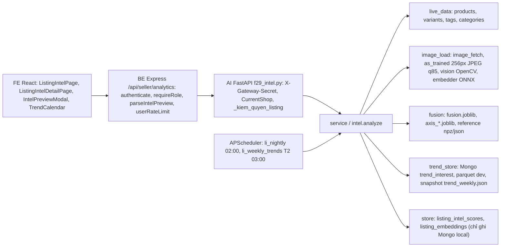

# Báo cáo kỹ thuật: Listing Intelligence (F29 v2)

Ngày viết: 2026-10-21 · Model đang phục vụ: `li-1.6` · Phạm vi: AI-Analysic, BE, FE · Người đọc: nhóm capstone, hội đồng, người triển khai.

Mọi con số trong tài liệu này lấy từ các nguồn dưới đây, ghi mã nguồn ngay cạnh số. Không có số nào được ước tính thêm. Số thập phân dùng dấu chấm như trong file kết quả.

| Mã | Nguồn |
|---|---|
| [R§n] | `docs/LISTING_INTEL_REPORT.md`, mục n (báo cáo đánh giá tự sinh, nguồn chính cho chỉ số) |
| [J] | `docs/listing_intel_results.json` |
| [M] | `app/core/listing_intel/model/meta.json` |
| [S§n], [P] | spec `docs/superpowers/specs/2026-10-21-listing-intelligence-design.md`; plan `docs/superpowers/plans/2026-10-21-listing-intelligence.md` |
| [Ledger] | `.superpowers/sdd/2026-10-21-listing-intelligence/progress.md` (mọi ruling và quyết định) |
| [Tn], [IT], [IR] | `task-n-report.md`; `iteration-li11-report.md` (li-1.1 → 1.4); `iteration-review.md` |
| [RA§n], [FR], [F1]–[F4] | `readiness-audit.md`; `final-review.md`; `golive-F1..F4-report.md` |
| [E2E-V], [E2E-F] | `e2e-verify-report.md` (lần 1); `e2e-final-report.md` (sau đợt sửa go-live) |
| [FF], [RR] | `final-fix-report.md` (đợt sửa cuối, li-1.6); `final-rereview.md` (re-review có phạm vi của đợt sửa cuối) |

Các file workspace nằm trong `vc-ai/AI-Analysic/.superpowers/sdd/2026-10-21-listing-intelligence/`.

---

## 1. Tóm tắt điều hành

**Tính năng làm gì.** Chấm một listing VietCraft theo 5 trục (ảnh, từ khoá, tag, thị hiếu và cạnh tranh, trend và mùa vụ), ra một điểm tổng 0–100 thay đổi theo ngày, 8 điểm theo tuần tới kèm sự kiện mua sắm, và tối đa 6 lời khuyên có nhãn chứng cứ và ước lượng mức tăng điểm. Có 4 endpoint (chi tiết, chấm thử bản nháp, danh sách theo shop, lịch trend 12 tuần), một trang FE "Phân tích listing", nút "Chấm thử trước khi đăng" trong form tạo sản phẩm, và trường `materials` mới ở BE và FE. Model học trên dữ liệu Tiki (2023 và 2026), không dùng LLM [S§1, S§2].

**Kết luận go-live.** Phần mã đã đạt điều kiện review toàn nhánh đặt ra: "Ready to go live once I1–I5 and M5 land" [FR, Final verdict], và đợt sửa cuối đã sửa đủ I1–I5, M5 cùng các mục E2E được chọn, bundle lên `li-1.6` [FF]. Re-review có phạm vi của đợt sửa cuối: đạt, 7/7 mục đã sửa, không có lỗi Critical/Important mới [RR]. Chưa đưa lên production được vì còn các việc ngoài mã dưới đây: Docker image chưa build, chưa commit, và production phải đặt `CLOUDINARY_CLOUD_NAME`. B1 (không ghi điểm lên production) là quyết định của người dùng, tính năng vẫn chạy được với quyết định này.

| Hạng mục | Trạng thái |
|---|---|
| Chạy đầu cuối trên stack local (AI 8010, BE, FE 3000, Mongo `vietcraft-test`) | Đạt: mọi kiểm tra API qua BE đạt, 0 lỗi console, không tràn ngang ở 1280 và 375 px [E2E-F §1–2]; chạy lại sau đợt sửa cuối trên BE 8084, `li-1.6` [FF] |
| Xác thực, quyền sở hữu, giới hạn đầu vào, chặn SSRF qua redirect, chỉ ghi DB local | Đạt [FR, Final verdict; RA§6] |
| **B1. Ghi điểm và embedding lên DB production** | **Tắt theo quyết định của người dùng** ("Chưa, để sau") [Ledger, mục F1]. Trang danh sách vẫn có điểm nhưng mỗi lượt xem tính lại tối đa 20 listing; embedding ảnh không được cache [FF #2] |
| **Docker image** | **Chưa build lần nào**; chỉ chạy `docker build --check` (không cảnh báo) [F1 §6; FR "Not run"] |
| **Commit** | **Chưa commit gì** ở cả 3 repo; cần người dùng đồng ý [Ledger, ruling đầu tiên; R§12 G4] |
| I1–I5, M5 của review cuối và các mục E2E được chọn | Đã sửa, có test và E2E [FF]; re-review: đạt, 7/7 mục đã sửa, không có lỗi Critical/Important mới (final-rereview.md). Xem mục "Cập nhật sau final fix" |
| `CLOUDINARY_CLOUD_NAME` | **Phải đặt ở production** (BE, nên đặt cả AI); nếu trống, khoá đường dẫn ảnh nhận mọi cloud [FF "Notes and risks"] |
| Dữ liệu trend | Chuỗi tuần dừng ở 2026-08-16; 15 từ khoá chưa thu được vì Google trả 429 [R§12 D14, V1]; lịch hiện "chưa có dữ liệu mới" cho mọi chip [FF] |
| Focus trap của modal chấm thử | Chưa có, đưa vào sprint sau [FR deferred] |

**Chỉ số chính (test tiki26, 782 dòng, 234 cụm seller)** [R§1, R§5]:

| Chỉ số | Giá trị | Cách đọc |
|---|---|---|
| ROC-AUC model gộp | 0.626, CI95 [0.539; 0.753]; AUC trong nhóm 0.651 | CI rộng vì tập nhỏ |
| Chênh với baseline mạnh nhất **trên test** (`TF-IDF tiêu đề + logistic`, AUC 0.600) | +0.0259, CI95 [-0.071; 0.119] | **Không có ý nghĩa**. Đây là quy tắc gắn nhãn của spec §1.2 |
| Chênh với baseline mạnh nhất **trên validation** (`Chỉ giá (log_price) + nhóm`, AUC test 0.557) | +0.0680, CI95 [0.019; 0.126] | Có ý nghĩa, chỉ để tham khảo, không dùng để gắn nhãn |
| Nhãn chứng cứ 5 trục | đều `practice` | Không trục nào được gắn "đã đo" |
| Cách chấm trục | ảnh: công thức; chữ: công thức; thị hiếu: model | Quyết định trên validation [R§5] |
| Số lần đọc test | 7, đã công bố đủ | Test không còn là ước lượng chưa từng xem [R§3] |

Vì vậy tính năng nên được trình bày là **công cụ gợi ý dựa trên thực hành tốt**, không phải dự báo doanh số trên VietCraft [R§11 manual; FR, Final verdict].

---

## 2. Bối cảnh và yêu cầu

**Vì sao làm.** Điểm sức khoẻ F29 v1 (`health-1.0`) là checklist trọng số tự đặt; tương quan với doanh số về sau chỉ 0.0305 trên 500 sản phẩm Olist, mục tiêu 0.65 chưa đạt (`notes/script-van-dap-AI.md` dòng 60, dẫn `docs/F29C_RESULTS.md`). Hội đồng hỏi "Áp dụng mô hình, phân tích dữ liệu đến mức độ nào?" (`notes/script-van-dap-AI.md` dòng 3). Spec đặt mục tiêu chấm listing "bằng dữ liệu và mô hình học từ TMĐT Việt Nam, không chỉ bằng checklist" [S§1].

**Nhận xét review đã định hình thiết kế** (mỗi dòng là một phát hiện của reviewer độc lập, đã xử lý):

| Nguồn | Nhận xét | Xử lý |
|---|---|---|
| Review Task 10 (I1) | Baseline mạnh nhất được chọn trên test; chọn trên validation cho kết quả khác | Báo cả hai, cổng gắn nhãn giữ cách chặt nhất của spec [Ledger ruling] |
| Review Task 10 (I2) | Nhãn chứng cứ tính trên test gộp, lời văn nói tiki26 | Ablation và nhãn tính trên test tiki26 [Ledger ruling] |
| Task 8, li-1.1 | Ngưỡng khớp trend bằng vector cos 0.80 khớp quá rộng | Hiệu chỉnh tay 100 cặp, tắt nhánh vector [R§8] |
| Review vòng lặp (A1–A4, C1) | Mục phương pháp sai, nhãn hàng model trục gây hiểu nhầm, điểm tổng lệch các trục | Sửa ở li-1.5 [F2] |
| Readiness audit (B1–B4) | 4 blocker production | B2, B3 đã sửa; B1 tắt theo người dùng; B4 chờ đồng ý [RA, F1] |
| Review cuối (I1–I5) | 5 lỗi Important nhỏ | Đã sửa ở li-1.6 [FF]; re-review: đạt, 7/7 mục đã sửa, không có lỗi Critical/Important mới (final-rereview.md) |

**Phạm vi** [S§2]. Trong phạm vi: 5 trục, `materials` ở BE và FE, 4 endpoint, job đêm và job tuần, trang FE và nút chấm thử, báo cáo. Ngoài phạm vi: viết lại F42, model uy tín shop, tự crawl Tiki, LLM chấm điểm, GPU hoặc torch trong module mới.

**Tiêu chí thành công của spec §1:**

| # | Tiêu chí | Kết quả | Đạt? |
|---|---|---|---|
| 1 | 4 bộ dữ liệu (train, validation, test tách theo shop, test lệch thời gian), baseline, kết quả trên dữ liệu thật của sàn | Có đủ train/val/test của 2 nguồn [R§2], test lệch thời gian [R§7], 5 baseline [R§5]. "Dữ liệu thật" là 29 sản phẩm mô phỏng ở `vietcraft-test`; 79 sản phẩm thật trên Atlas chưa được chấm [R§11, D12] | Một phần |
| 2 | Model gộp thắng baseline mạnh nhất trên test, CI không chứa 0; nếu không thì nói thẳng và không gắn "đã đo" | +0.0259 [-0.071; 0.119], không thắng; báo cáo nói rõ, mọi trục `practice` [R§1] | Không thắng; nhánh "nói thẳng" đã làm đúng |
| 3 | Ablation từng trục; "đã đo" khi lift ≥ 0.005 và CI không chứa 0 | Có ablation 4 trục học được; không trục nào đạt (chữ +0.0321 [-0.013; 0.075]) [R§6] | Quy trình đạt; không trục nào "đã đo" |
| 4 | Dự báo 8 tuần MASE < 1 trên phần lớn từ khoá; đỉnh điểm ở tuần trước dịp | Luật chọn của spec: mốc cuối 66.7% (đạt), trung bình 6 mốc 48.9% (không đạt); đỉnh rơi vào −4…0 tuần ở 84.6% của 52 cặp [R§8] | Một phần |
| 5 | Endpoint chạy trên stack local, FE đủ, chấm thử bản nháp < 3 s sau khi nạp model | Chấm thử 0.18–0.28 s, chi tiết 0.18–0.31 s (ấm) [E2E-F §1]; bản nháp 3 ảnh 0.292 s ở li-1.1 [IT] | Đạt |
| 6 | Báo cáo có kết quả, drawback, sanity, điểm yếu; điểm yếu sửa được đã sửa và đo lại | Có đủ [R§9, R§12]; §11 đã đo lại trên mã cuối li-1.6 [FF #5] | Đạt |

---

## 3. Kiến trúc tổng thể

Ranh giới module theo spec §4: `embedder` là chỗ duy nhất biết ONNX; `vision` không biết Mongo; mỗi trục nhận `ListingInput` và trả `AxisResult`; `store` là chỗ duy nhất ghi Mongo. Script offline `scripts/li/` gọi cùng hàm feature (`features.assemble`) với runtime, nên train và phục vụ dùng một đường tính feature [S§4; IR "Verified"].

**Luồng request** (mã đọc từ `f29_intel.py`, `service.py`, `intel.py`):

| Luồng | Đi qua | Đọc | Ghi | Ghi chú |
|---|---|---|---|---|
| Chi tiết `GET /listings/:id/intel?date=` | `_day` (±730 ngày) → `_kiem_quyen_listing` → `load_listing` → `analyze` | sản phẩm, tối đa 300 peer cùng nhóm, tag, ảnh (cache rồi mới tải), trend | điểm và embedding chỉ khi `date` là hôm nay và Mongo là local | Ngày khác hôm nay không ghi |
| Chấm thử `POST /listings/intel/preview` | BE `userRateLimit` 20/phút → `parseIntelPreview` → AI pydantic → `analyze(persist=False, store_embeddings=False)` | như trên | không ghi gì | Phản hồi không có `product_id` [F1 §6] |
| Danh sách `GET /listings/intel` | `shop_summary` | `latest_scores` lọc theo `model_version` | chấm tối đa `MAX_SYNC = 20` listing chưa có điểm, ghi nếu local | Điểm vừa tính đưa thẳng vào kết quả, `computed_at` = lúc tính, nên trên Atlas vẫn có điểm; chi phí tính lại mỗi lượt xem còn [FF #2] |
| Lịch `GET /trends/calendar?category=` | `service.calendar` | sự kiện 12 tuần tới, chuỗi trend | không | Lọc theo nhóm của shop; từ khoá lấy theo chủ đề của dịp (`seed_keywords`), xếp theo đỉnh mùa vụ trong cửa sổ chuẩn bị; đà tăng `null` khi chuỗi dừng quá 4 tuần [FF #7] |
| Job đêm `li_nightly` | `jobs.nightly` | listing có `updated_at` mới hơn điểm cuối cùng phiên bản | điểm (chỉ local) | Trên Atlas không có điểm nào nên tính lại mọi sản phẩm mỗi đêm, không lưu gì (M4 còn mở) [FR M4] |
| Job tuần `li_weekly_trends` | ping Mongo local 2 s rồi chạy `collect_trend_keywords --refresh` | Google Trends | `data-collection.trend_interest` local | Không có Mongo local thì log INFO và dừng [F1 fix round 1] |

---

## 4. Dữ liệu

Dữ liệu ngoài nằm ở `vietcraft/data-li/` và Mongo local, ngoài 3 repo git; chỉ dùng cho học thuật, không phân phối lại, không commit CSV hay ảnh [S§3].

| Tên | Nguồn | Kích thước | Vai trò |
|---|---|---|---|
| `tiki23` | Kaggle `michaelminhpham/vietnamese-tiki-e-commerce-dataset` | 41,603 thô → 41,575 sạch [R§2] | Học chữ, giá, metadata; nhóm accessories, bags, shoes; không có ảnh |
| `tiki26` | Kaggle `huyhoang1308/tiki-csv` (Apache-2.0, crawl 2026-04-18) [S§3] | 8,169 thô → 3,998 sạch [R§2]; 3,997/3,998 ảnh tải được [T8] | Học đủ trục; nhóm fashion, home, sport; test chính |
| `tikifashion` | Kaggle `giaphoangkim/tiki-fashion` | 22,334 dòng [S§3], lấy mẫu 5,000 ảnh [R§2] | Kiểm tra retrieval ảnh–chữ, khớp danh mục |
| `tikireviews` | Kaggle `farmingfree/vietnamese-e-commerce-suspicious-reviews-dataset` | 584,005 dòng [S§3] → chỉ số tháng của bags 5,599, fashion 22,893, home 552,232 review [R§2] | Mùa vụ nhóm khi không khớp từ khoá trend |
| `trends` | Mongo `data-collection.trend_interest` | 45 từ khoá × 262 tuần (snapshot 212 KB) [F1 §3]; 15 từ khoá chưa thu [R§8] | Chỉ số mùa và đà tăng |
| `vietcraft-test` | Mongo local | 29 sản phẩm, 8 shop, 16 có ảnh tải được [R§11] | Chạy thật, đo độ phủ và độ lệch |
| Atlas `vietcraft` (chỉ đếm) | Mongo production | 79 sản phẩm, 16 shop, 4 đơn; 78/79 có ảnh Cloudinary; 0/79 có `materials` [RA§7] | Kiểm tra độ phủ danh mục: 79/79 ánh xạ được |

**Làm sạch** (`scripts/li/ingest.py`, [T1]): bỏ dòng thiếu tên hoặc giá, giá ≤ 0; chỉ giữ danh mục ánh xạ được trong `category_map.json`; bỏ trùng id (tiki23 có 27 id trùng giữa các file). Seller của tiki26 là `seller_id`, nếu thiếu thì `brand_name`; brand giữ chỗ (OEM, no brand, không thương hiệu) coi là thiếu và mỗi dòng thành một cụm riêng (khoảng 26% dòng) [Ledger ruling; R§12 D4]. Chỉ số tháng `tikireviews` detrend theo từng năm, chỉ dùng năm đủ 12 tháng, bỏ nhóm < 5,000 review (shoes có 651) [T1 fix round 1].

**Nhãn.** `top25` = thuộc 25% `quantity_sold` cao nhất trong cùng (nguồn, nhóm); với tiki23 xếp theo `sold / max(tuổi_ngày, 30)`. `age_days` không bao giờ là feature. Các cột suy ra từ đáp án (review, rating, favourite, order, revenue…) bị loại [S§3; P Global Constraints].

**Chia tập** (`GroupShuffleSplit` theo seller, 70/15/15, `random_state=42`) [R§2]:

| Nguồn | Tập | Số dòng | Tỉ lệ top25 | Seller | Dòng không có seller |
|---|---|---|---|---|---|
| tiki23 | train / val / test | 27,693 / 7,206 / 6,676 | 0.255 / 0.232 / 0.250 | 2,664 / 571 / 571 | 0 |
| tiki26 | train / val / test | 2,709 / 507 / 782 | 0.244 / 0.201 / 0.294 | 350 / 71 / 81 | 739 / 163 / 153 |

**Kiểm soát rò rỉ** [IR "Verified"; R§9; T8]:

| Kiểm soát | Bằng chứng |
|---|---|
| 0 seller nằm ở 2 tập trong cùng nguồn | Kiểm tra lại: train-val, train-test, val-test đều 0 ở cả 2 nguồn [R§9] |
| Lift n-gram và tâm nhóm top/rest của dòng train là out-of-fold (5 fold theo seller) | `fit_context.py:164-169` [IR] |
| PCA, giá trung vị nhóm, chỉ mục kNN chỉ fit trên train; kNN của dòng train bỏ mọi láng giềng cùng seller | `knn_dup_count` train 1.20 → 0.52 sau sửa [R§10 manual] |
| Chuỗi trend cắt tại ngày thu dữ liệu (`at`) | `build_features.py:33-38` [IR]; test nhìn trước ở Task 5 [T5 fix round 1] |
| Không cột cấm trong 56 cột feature | Đạt [R§9] |
| Hạn chế còn lại | 46 dòng val/test trùng tên seller với train của nguồn kia (chỉ ảnh hưởng tập gộp); `group_season` gộp mọi năm (nhìn trước nhẹ với tiki23) [R§12 M9] |

**Giới hạn sử dụng.** Hai nguồn không chung nhóm nào, nên cột `group` cũng nhận diện nguồn [R§3]. tiki26 không có mô tả (`desc_len = 0` mọi dòng) và không có `n_images`; tiki23 không có ảnh [R§3, D5, D6]. **Giấy phép** (kiểm từ trang dataset và model, nghiên cứu ngày 21/10):

| Nguồn | Giấy phép | Hệ quả |
|---|---|---|
| Model `google/siglip2` (bản ONNX dùng ở đây) | Apache-2.0 | dùng được, giữ ghi chú giấy phép |
| `huyhoang1308/tiki-csv` (tiki26) | Apache-2.0 | dùng được |
| `michaelminhpham/vietnamese-tiki-e-commerce-dataset` (tiki23) | "Other": crawl từ API công khai của Tiki, mục đích giáo dục | chỉ dùng cho học thuật |
| `giaphoangkim/tiki-fashion` | Unknown | chỉ dùng cho học thuật, không phân phối lại |
| `farmingfree/vietnamese-e-commerce-suspicious-reviews-dataset` | CC BY-NC-SA 4.0 | chỉ học thuật, phi thương mại |

Vì vậy dữ liệu chỉ dùng cho học thuật, phi thương mại, không phân phối lại. Bundle không chứa ảnh, CSV hay parquet [FR "Rules"], nhưng có dữ liệu suy ra từ Tiki: vector kNN float16 kèm giá và nhãn top25 (ví dụ `knn_fashion.npz` 1,441 dòng), bảng lift n-gram, và mẫu tiêu đề tiki26 đã chấm tay trong `trend_calib_judged.json`. Cần cân nhắc điều này trước khi phát hành bundle ra ngoài phạm vi học thuật.

---

## 5. Năm trục

| Trục | Đầu vào | Cách chấm đang phục vụ | Vì sao | Nhãn | Giới hạn đã biết |
|---|---|---|---|---|---|
| Ảnh | Ảnh đầu tiên tải được, qua `as_trained` (256 px, JPEG q85); 9 số đo OpenCV, độ khớp tiêu đề và danh mục, kiểu ảnh từ SigLIP2 | Công thức `c8_rel_sharp_flags_0.05`, phân vị so với listing Tiki cùng nhóm [R§5] | Model ảnh học không bền: p90 lệch 33.8 điểm trên validation, so với 13.3 của công thức [R§5]; AUC test model 0.486 [R§5] | practice | Công thức không dự báo bán chạy: AUC validation 0.489, test 0.561 (đo hậu kiểm) [R§5]; bất biến chỉ đạt theo trung vị (p90 14.7) [R§9] |
| Từ khoá (chữ) | Tiêu đề và chất liệu khai báo; độ dài, lặp từ, từ cấm (87 cụm), thuộc tính, log-lift n-gram | Công thức, phân vị so với Tiki cùng nhóm; trừ 0.15 cho mỗi thuộc tính bắt buộc thiếu [R§5] | Model chữ có cận dưới CI validation tiki26 ≤ 0.5 (0.462 [0.383; 0.589]) [R§5] | practice | Công thức: validation 0.577, test 0.576 [R§5]; lexicon còn khớp nhầm ("Cam kết" → màu cam) [R§12 P4] |
| Tag | Tag của listing, bảng lift, từ khoá trend đang lên, tag chờ duyệt/đã duyệt | Công thức `tag_report` (lift 0.35, trend 0.25, cos 0.20, thuộc tính 0.20; −0.1 mỗi tag trùng, −0.05 mỗi tag chờ duyệt), phân vị so với tối đa 300 listing VietCraft cùng nhóm (`tags_axis.py`, `peers.py`) | Tiki không có tag, không học có giám sát được [S§5] | practice (luôn) | Phần cos không vào điểm vì runtime không nhúng tag peer [T11 concern 5]; gợi ý tag chỉ lấy từ lexicon hoặc tag đã duyệt [F1 fix round 1] |
| Thị hiếu và cạnh tranh | Vector ảnh + tiêu đề, giá; kNN 20 láng giềng trong chỉ mục Tiki train của nhóm | Model HGB trên 3 cột (`knn_price_pct`, `knn_dup_count`, `top_centroid_margin`) + nhóm, phân vị so với Tiki | AUC validation 0.616 [0.544; 0.703], cận dưới > 0.5 [R§5] | practice | Test 0.557 [0.493; 0.644] [R§5]; không có chỉ mục kNN cho bags, shoes, accessories (9/79 sản phẩm Atlas) [R§12 P19] |
| Trend và mùa vụ | Từ khoá khớp chữ đã bỏ dấu trong tiêu đề; chuỗi tuần; mùa vụ nhóm `tikireviews` | `h(d)` = trung bình theo từ khoá của chỉ số mùa × (1 + đà tăng 4 tuần cắt ±0.5), cắt [0.5; 1.5]; không khớp thì mùa vụ nhóm hoặc 1.0 [R§8]. Điểm trục = phân vị của `h(d)` so với peer VietCraft cùng ngày | Theo spec §5; khớp vector bị tắt vì chỉ 1/100 cặp đúng [R§8] | practice | Độ phủ khớp chữ chỉ 2.5% (tiki23) / 8.2% (tiki26) [R§1]; dữ liệu dừng 2026-08-16 [R§12 D14] |

**Trọng số công thức** (`formulas.py`, [R§5]): ảnh `sharpness_rel` 0.3, `exposure_ok` 0.05, `contrast_ok` 0.05, border 0.3, `no_text` 0.15, resolution 0.05, `sim_title` 0.05, `sim_category` 0.05; chữ: thuộc tính 0.35, độ dài tiêu đề 0.2, keyword lift 0.25, sạch 0.2. Thuộc tính bắt buộc: chất liệu ở accessories, bags, fashion, shoes; màu và size ở fashion, shoes [R§5].

**Lời khuyên** (`advice.py`): mỗi vấn đề thành một mục `{axis, code, message, evidence, effort 1|2|3, impact}`, xếp theo (đã đo, impact, ít công sức), tối đa 6 mục; `missing_material` và mục có impact dương lớn nhất luôn được giữ [FF #3]; `missing_material` luôn `practice`. `impact` là counterfactual trên model: thay feature bằng trung vị nhóm top25 của train, đo trên thang điểm hiển thị [F1 fix round 1]. Từ li-1.6, "thêm ảnh" (`no_images`) thay cả 31 cột ảnh bằng trung vị top25 của nhóm, nên listing không ảnh có impact: 12/13 listing không ảnh local có impact > 0, trung vị +19.6 [R§11]. Đây là ước lượng, không phải nhân quả [R§12 P3].

---

## 6. Mô hình và đánh giá

### 6.1 Feature và model

| Nhóm feature | Số cột | Cột |
|---|---|---|
| Meta | 3 | `log_price`, `price_rel`, `n_images` |
| Chữ | 15 | độ dài và số từ tiêu đề, tỉ lệ viết hoa, tỉ lệ lặp, từ cấm, độ dài và số từ mô tả, 5 cờ thuộc tính, 3 cột `kw_lift_*` |
| Ảnh | 31 | 9 số đo OpenCV, `sim_title`, `sim_category`, 4 `style_*`, 16 `emb_pca_*` |
| Thị hiếu | 3 | `knn_price_pct`, `knn_dup_count`, `top_centroid_margin` |
| Trend | 3 | `trend_factor`, `trend_matches`, `trend_momentum_max` |
| Nhóm | 1 | `group` (category) |

Tổng 56 cột [R§3; IT "Task 8 documentation"].

| Model | Tham số | Số vòng thực tế | Học trên |
|---|---|---|---|
| fusion, text, market | `HistGradientBoostingClassifier(learning_rate=0.05, max_iter=400, random_state=42)`, `early_stopping` auto | fusion 171, text 166, market 400 [M `n_iter`] | `split == train` của 2 nguồn: 30,402 dòng [M `train_data`] |
| image (không phục vụ) | `max_depth=4, min_samples_leaf=40, l2_regularization=1.0, max_iter=10, early_stopping=False`, chọn trên lưới 241 cấu hình | 10 | như trên |

Embedder: SigLIP2 `onnx-community/siglip2-base-patch16-224-ONNX`, int8, CPU, vector 768 chiều, chạy từng mẫu một (batch 1) vì bản int8 phụ thuộc lô; sau sửa, cos giữa gọi riêng và gọi chung là 1.0 [improve-embedder-report; R§9].

### 6.2 Kết quả và baseline (test tiki26) [R§5]

| Phương pháp | ROC-AUC | CI95 | AUC trong nhóm | NDCG@10 | Top 20% trúng |
|---|---|---|---|---|---|
| Model gộp | 0.626 | [0.539; 0.753] | 0.651 | 0.601 | 44.9% |
| TF-IDF tiêu đề + logistic | 0.600 | [0.518; 0.701] | 0.622 | 0.612 | 42.9% |
| Chỉ giá (log_price) + nhóm | 0.557 | [0.482; 0.654] | 0.585 | 0.577 | 33.3% |
| Model thị hiếu (đang phục vụ) | 0.557 | [0.493; 0.644] | 0.575 | 0.612 | 36.5% |
| Công thức ảnh (đang phục vụ, hậu kiểm) | 0.561 | [0.443; 0.631] | 0.522 | 0.566 | 41.0% |
| Công thức chữ (đang phục vụ, hậu kiểm) | 0.576 | [0.500; 0.642] | 0.510 | 0.518 | 35.3% |
| health-1.0 | 0.500 | [0.500; 0.500] | 0.500 | — | 29.4% |
| Ngẫu nhiên | 0.517 | [0.477; 0.557] | 0.513 | 0.504 | 32.1% |

Tập phụ: test tiki23 model gộp 0.712 [0.677; 0.742]; test gộp 0.700 [0.666; 0.732]. Chênh với TF-IDF: tiki23 +0.0201 [-0.014; 0.053], gộp +0.0180 [-0.018; 0.050], đều không có ý nghĩa [R§5]. CI95: bootstrap 200 lần theo cụm seller, chênh dùng bootstrap ghép cặp [R§3].

### 6.3 Ablation, lệch thời gian, trend

| Trục bỏ ra | AUC giảm | CI95 ghép cặp | Nhãn |
|---|---|---|---|
| Ảnh | +0.0093 | [-0.019; 0.053] | practice |
| Từ khoá (chữ) | +0.0321 | [-0.013; 0.075] | practice |
| Thị hiếu | -0.0030 | [-0.020; 0.029] | practice |
| Trend | -0.0023 | [-0.020; 0.014] | practice |

Nguồn: [R§6], 782 dòng test tiki26.

| Test lệch thời gian (tiki23 → tiki26) [R§7] | AUC | Chênh với học tại chỗ |
|---|---|---|
| Học toàn bộ tiki23 (2023), chấm tiki26 test (2026) | 0.554 [0.482; 0.645] | -0.0544 [-0.130; 0.039] |
| Học tiki26 train, cùng feature | 0.608 [0.537; 0.709] | — |

Hai nguồn không chung nhóm, nên đây là lệch cả thời gian lẫn danh mục [R§7].

| Trend [R§8] | Kết quả |
|---|---|
| Tỉ lệ từ khoá MASE < 1, mốc cuối (STL / naive / luật chọn) | 68.9% / 71.1% / 66.7% |
| Trung bình 6 mốc trượt (STL / naive / luật chọn) | 46.7% / 46.7% / 48.9% |
| Đỉnh `mùa × (1 + đà tăng)` trong −4…0 tuần trước dịp | 84.6% của 52 cặp (từ khoá, năm); ngoại lệ "quà tặng người yêu" đỉnh sau Valentine +1.5 tuần |
| Tương quan mùa vụ Google Trends với `tikireviews` | bags r 0.316 (p 0.317), fashion r -0.142 (p 0.660), home r 0.399 (p 0.199): không nhóm nào có ý nghĩa |
| Hiệu chỉnh khớp vector (100 cặp chấm tay) | đúng chặt 1/100, nới 4/100; khớp chữ 20/20 → tắt nhánh vector |

Runtime không dùng dự báo mức trong bảng; `h(d)` chỉ là mùa × đà tăng [R§8].

### 6.4 Sanity check [R§9]

| Kiểm tra | Kết quả | Đạt |
|---|---|---|
| Xáo trộn nhãn train (5 seed) | AUC trung bình test tiki26 0.4952, gộp 0.5136 | đạt |
| Không seller ở 2 tập | 0 ở mọi cặp tập, cả 2 nguồn | đạt |
| Không cột cấm | 56 cột, không cột nào lọt | đạt |
| Tất định | học lại 2 lần giống hệt, giống bundle | đạt |
| Bất biến ảnh, trục đang phục vụ (50 ảnh test qua `as_trained`, ngưỡng ≤ 5 điểm) | trung vị sáng +10% 4.3, tối −10% 2.81, JPEG q70 2.59; p90 14.7 / 10.08 / 11.13 | đạt theo trung vị |
| Phát hiện ảnh trùng (dHash) | Hamming trung vị bản biến đổi 0–1, giữa 2 ảnh khác nhau 28 | — |
| Retrieval ảnh–caption (200 cặp tikifashion) | top-1 ảnh→chữ 34.0%, chữ→ảnh 23.0%, recall@5 65.0%, gấp 68 lần ngẫu nhiên | — |

Kiểm tra xáo trộn nhãn không bắt được rò rỉ qua feature suy từ nhãn; lập luận chống rò rỉ dựa vào đường code out-of-fold ở mục 4 [R§12 M8].

### 6.5 Công bố số lần đọc test [R§3, khối manual:reads]

| Lần | Phiên bản | Đọc gì |
|---|---|---|
| 1 | li-1.0 | đánh giá đầu tiên |
| 2 | li-1.1 | sau khi nhúng lại; model ảnh 0.528 |
| 3 | li-1.2 | model giống li-1.1 từng byte; quy tắc model/công thức đưa ra ngay sau lần 2 |
| 4 | li-1.3 | model ảnh chọn lại trên lưới 241 cấu hình; test 0.486 |
| 5 | li-1.4 | công thức ảnh; test chỉ đo bất biến |
| 6 | review vòng lặp | AUC test của công thức đang phục vụ (ảnh 0.561, chữ 0.576), chỉ mô tả |
| 7 | li-1.5 | chạy lại train và evaluate; bất biến qua `as_trained`; phép thử cách điền feature không ảnh in cả số validation và test |

Validation tiki26 (507 dòng) đóng 5 vai: chọn feature, quyết định model hay công thức, chọn cấu hình ảnh, thiết kế công thức ảnh, dựng phân phối tham chiếu. Các quyết định ở lần 3–5 có lý do trên validation nhưng đưa ra sau khi đã thấy test (forking paths), nên số test nên đọc như một ước lượng hơi lạc quan [R§3].

### 6.6 Lịch sử phiên bản [R§10; Ledger; IT; F2]

| Phiên bản | Thay đổi chính | Model gộp test | Trục ảnh phục vụ (test) |
|---|---|---|---|
| li-1.0 | bản đầu; embedder batch 16–256 | 0.619 [0.529; 0.735] | model 0.539; bất biến không đạt (8.65–10.63) |
| li-1.1 | embedder batch 1, dựng lại bảng; tắt khớp trend vector; kNN bỏ cùng seller; bundle không parquet | 0.626 [0.539; 0.753] | model 0.528; bất biến không đạt (13.0–14.4) |
| li-1.2 | quy tắc cổng trục trên validation; trục chữ thành công thức | không đổi (byte-identical) | model 0.528 |
| li-1.3 | trục ảnh chọn lại trên lưới 241 cấu hình; công thức chữ chỉ dùng tiêu đề | không đổi | model 0.486; trung vị lệch 0.0 nhưng p90 24.6–27.8 |
| li-1.4 | trục ảnh thành công thức bền với phơi sáng | không đổi | công thức; trung vị 3.85 / 0.93 / 2.63 |
| li-1.5 | chỉ đổi meta, reference, báo cáo: `feature_availability`, `feature_constants`, `image_impute`, `pca.npz`, khoá 45 từ khoá trend, AUC công thức | không đổi | công thức 0.561 (hậu kiểm); bất biến qua `as_trained` 4.3 / 2.81 / 2.59 |
| li-1.6 | chỉ đổi `reference/top_medians.json`: lời khuyên "thêm ảnh" có impact cho listing không ảnh | không đổi (không chấm lại test) | không đổi |

### 6.7 Điểm phục vụ khác hàm đã đo AUC

Mọi AUC trong báo cáo, kể cả AUC trên thẻ model ở giao diện, là của model gộp thô trên dòng Tiki [R§3]. Runtime (`fusion.served`, `fusion._scores`) làm thêm:

| Bước | Làm gì | Số đo |
|---|---|---|
| (a) Che | Đặt NaN các feature có `feature_availability` < 0.01 trong nhóm (ví dụ `n_images` ở fashion, home, sport; ảnh và thị hiếu ở nhóm tiki23) | Không đổi AUC trên dòng Tiki (availability ≥ 0.99) [FR "Train/serve parity"] |
| (b) Hằng số | Đặt feature trong `feature_constants` về giá trị duy nhất lúc học (fashion/home: `desc_len` 0, `desc_words` 0, `img_w` 256, `img_h` 256, `img_aspect` 1.0, `title_banned` 0) [M] | 29 sản phẩm local: trung vị base 19.8 → 8.0, lệch lớn nhất 51.8 (fashion) [F1 fix round 1] |
| (c) Điền ảnh | Listing không ảnh được điền 31 cột ảnh bằng vector của ảnh train làm điểm model gộp thấp nhất trong nhóm; cột thị hiếu để trống | Bản bỏ ảnh cao điểm hơn bản có ảnh: 0.6% dòng validation, 0.8% test; nếu điền q10 thì 44.4% / 43.0% [R§9] |
| (d) Sàn không ảnh | điểm = max(model(listing), model(listing bỏ ảnh)) | Đổi điểm ở 0.6% validation, 0.8% test [R§3] |
| Phân vị | Xác suất → phân vị theo `score_dist` của nhóm (dòng Tiki validation) | Điểm tổng là phân vị so với Tiki, không so với VietCraft [FR I4] |
| `h(d)` | `score(d) = clip(base × h(d), 0, 100)`; timeline 8 tuần dùng `h` của từng tuần | Ví dụ 6ad3124c: 93.36 hôm nay, 84.70 ngày 2026-11-15 (h 1.0703 → 0.9816) [E2E-F #4] |

Ảnh hưởng của (a)–(c) lên AUC trên dòng Tiki chưa được đo riêng [R§3]. Hệ quả trên dữ liệu local (29 sản phẩm, mã cuối li-1.6): tứ phân vị điểm tổng 2.86 / 8.12 / 48.0; trung vị có ảnh 20.03, không ảnh 2.86 [R§11]. Listing không ảnh nằm gần đáy; phản hồi có `capped_reason: "no_images"` và FE hiện "Điểm tổng thấp vì sản phẩm chưa có ảnh" kèm impact ước tính (ví dụ +26.8 trong E2E) [FF #3, #4]. Điểm tổng vẫn phân cực so với các trục (9/14 listing ở 1–8 điểm lúc E2E cuối) [E2E-F N1].

---

## 7. API contract

Envelope dùng chung của nhóm F: `ok` hoặc `insufficient`, `meta.model_version` (`li-1.6`), `meta.degraded` khi thiếu model ONNX [F1 §2; `f29_intel.py`].

| BE (`/api/seller/analytics`) | AI | Tham số | Trả về |
|---|---|---|---|
| `GET /listings/intel` | `GET /api/analytics/listings/intel` | — | `IntelList {items[], total}` |
| `GET /listings/:id/intel` | `GET /api/analytics/listings/{id}/intel` | `date=YYYY-MM-DD`, cách hôm nay ≤ 730 ngày | `ListingIntel` |
| `POST /listings/intel/preview` | `POST /api/analytics/listings/intel/preview` | body bản nháp | `ListingIntel` (không có `product_id`) |
| `GET /trends/calendar` | `GET /api/analytics/trends/calendar` | `category` (tuỳ chọn) | `IntelCalendar {events[]}` |

**Trường của `ListingIntel`** (`FE/src/modules/analytics/intelTypes.ts`, khớp đủ key, null và enum theo [FR "Contract"]):

| Trường | Kiểu | Ý nghĩa |
|---|---|---|
| `score`, `base`, `demand_factor` | number, number\|null, number\|null | điểm theo ngày, điểm gốc, `h(d)` |
| `score_timeline[]` | `{week_start, score, demand_factor, events: string[]}` | 8 tuần tới |
| `axes.{image,text,tags,market,trend}` | `{score\|null, evidence, metrics, issues[], missing_reason?}` | trục null hiện "Thiếu dữ liệu" kèm lý do |
| `material` | `{declared[], detected[], required, missing}` | chất liệu khai báo và nhận ra từ chữ |
| `keywords[]` | `{term, lift\|null, trend: up\|flat\|down\|null, in_title}` | tối đa 10 |
| `tags[]`, `suggested_tags[]` | `{tag, verdict: keep\|weak\|duplicate\|pending, reason}`, `{tag, reason}` | tối đa 3 gợi ý |
| `images[]` | `{url, metrics, issues[], style\|null, sim_title\|null}` | tối đa 8 ảnh |
| `market` | `{price_pct, neighbors, near_duplicates, median_price}` \| null | 20 láng giềng |
| `advice[]` | `{axis, code, message, evidence, effort: 1\|2\|3, impact\|null}` | tối đa 6 |
| `peers`, `model` | `{group\|null, size}`, `{version, auc, auc_ci95, best_baseline, trained_on}` | thẻ model |
| `capped_reason` | `'no_images'` \| null | `no_images` khi listing không có URL ảnh; FE hiện thông báo riêng (thêm ở li-1.6) [FF #4] |
| `title?`, `thumbnail?`, `product_id?`, `date?` | | chỉ ở chi tiết; preview bỏ `product_id` |

`IntelListItem`: `{product_id, title, thumbnail, score\|null, axes{5 trục: number\|null}, trend_direction, computed_at}`. Sự kiện lịch: `{key, name, date, prep_start, groups[], keywords[{term, momentum}]}`.

**Giới hạn body chấm thử:**

| Trường | BE `parseIntelPreview` | AI pydantic `IntelPreviewBody` |
|---|---|---|
| `title` | bắt buộc, trim, 1–200 | 1–200 |
| `description` | ≤ 5000 | ≤ 5000 |
| `category` | ≤ 80 | ≤ 100 |
| `price` | số hữu hạn 0…1e9, tuỳ chọn | 0…1e10, tuỳ chọn |
| `tags` | ≤ 20, mỗi tag sau trim 1–40 | ≤ 20, mỗi mục ≤ 40 |
| `materials` | phải là mảng; NFC, trim, cắt 40 code point, bỏ trùng không phân biệt hoa thường, tối đa 5 | ≤ 5, mỗi mục ≤ 40 |
| `image_urls` | ≤ 8, mỗi URL ≤ 2048, chỉ `/<cloud>/image/upload/` của Cloudinary (mục 10) | ≤ 8, `image_fetch.allowed` (cùng luật đường dẫn) |

**Lỗi:**

| Mã | Khi nào | Nguồn |
|---|---|---|
| 400 `invalid_param` | ngày sai định dạng hoặc quá ±730 ngày (FE hiện "Ngày xem điểm không hợp lệ…"); body sai (`title`, `image_urls`…, kể cả `../`, `%2e%2e`, `/image/fetch/`); AI đổi 422 thành 400 | [E2E-F #8, #13–15, #18; FF] |
| 401 | thiếu token | [E2E-F #16] |
| 403 `forbidden` | listing của shop khác | [E2E-F #6] |
| 404 `not_found` | id không có hoặc sai dạng | [E2E-F #17] |
| 429 `rate_limited` | lần chấm thử thứ 21 trong 60 s, kèm `Retry-After`; FE hiện `body.message` tiếng Việt | [E2E-F #12; FF #7] |
| 200 `insufficient_data` | chưa có bundle, lệch phiên bản sklearn, shop chưa cấu hình | [T11 fix round 1 #10] |
| 503 `ai_gateway_not_configured` | BE thiếu `AI_GATEWAY_SECRET` | [RA§3] |
| 500 | file bundle hỏng (chỉ bắt `FileNotFoundError`, `RuntimeError`) | còn mở [FR M10] |

**Xác thực:** BE `authenticate` + `requireRole(seller|admin)`, shop id lấy ở server; AI kiểm `X-Gateway-Secret` bằng `hmac.compare_digest`; route chi tiết kiểm sở hữu bằng `_kiem_quyen_listing` [RA§6].

---

## 8. FE

| Thành phần | File (`FE/src/modules/`) | Ghi chú |
|---|---|---|
| Route và nav | `analytics/InsightsPortal.tsx`, `nav.ts` | `insights/listing-intel`, `insights/listing-intel/:id`; mục "Phân tích listing" (F29 v2) trong nhóm "Nhìn vào trong" [T7] |
| Trang danh sách | `analytics/pages/ListingIntelPage.tsx` (34 dòng) | `IntelTable` (từ md) hoặc `IntelCardList` (dưới md), cột phải `TrendCalendar` |
| Trang chi tiết | `analytics/pages/ListingIntelDetailPage.tsx` (91 dòng) | ô ngày gắn `?date=`, nút "Hôm nay"; `key={id}` để không lẫn tiêu đề giữa 2 sản phẩm [cleanup-fe-report] |
| Báo cáo | `components/intel/IntelReport.tsx` | tiêu đề điểm: "Phân vị so với listing Tiki tham chiếu nhóm X; tag và trend so với N listing VietCraft" [FF #4]; `ScoreCard` + `AxisRadar`, `AdviceList`, `ImagePanel`, `KeywordPanel`, `TagPanel`, `MarketPanel`, `ModelCard`, `TrendTimeline`; `compact` cho modal |
| Nhãn | `components/intel/intelLabels.ts` | nhãn tiếng Việt cho trục, nhãn chứng cứ, nhóm, hướng, mã vấn đề ảnh |
| Chấm thử | `seller/components/create-product/IntelPreviewSection.tsx`, `previewDraft.ts`, `components/intel/IntelPreviewModal.tsx`, `useIntelPreview.ts` | nút bị khoá khi chưa có tiêu đề |
| Chất liệu | `product/components/MaterialInput.tsx` (88 dòng) | chip, tối đa 5, 40 ký tự, `datalist` 37 gợi ý (khớp 37/37 term của lexicon [FR]) |

**Luồng chấm thử:** Step 4 của wizard → `previewDraft` dựng bản nháp (cắt độ dài theo giới hạn BE, bỏ `price` khi chưa biết) → modal chỉ giữ URL dạng `https://res.cloudinary.com/<cloud>/image/upload/…` (cloud lấy từ `VITE_CLOUDINARY_CLOUD_NAME`, nếu trống thì nhận mọi cloud), bỏ trùng, tối đa 8, báo số ảnh bị bỏ → POST [FF #1]. Ảnh trong luồng tạo sản phẩm thường chưa lên Cloudinary nên trục ảnh hay "Thiếu dữ liệu" cho tới khi đăng [R§12 K8].

**Truy cập và di động:**

| Có | Còn thiếu |
|---|---|
| Modal `role=dialog`, `aria-modal`, Esc để đóng, nút đóng có nhãn và tự focus | Modal chưa có focus trap (đưa vào sprint sau, không bỏ) [FR deferred] |
| `MaterialInput`: bỏ Enter khi đang gõ IME (kể cả keyCode 229), trả focus sau khi thêm/xoá, thông báo `role=status`; ô ngày có `min`/`max` ±730 ngày [FF #7] | Modal chấm thử chưa chụp lại sau đợt sửa (luồng tạo sản phẩm tải ảnh lên Cloudinary thật) [FF] |
| `InfoTip` mở cả khi focus bàn phím; lịch có chữ `sr-only` cho mũi tên, nổi bật mùa chuẩn bị bằng viền, chữ và icon (không chỉ màu) [fe-calendar-report] | Ở 375 px bảng từ khoá (400 px trong 241 px) và bảng timeline vẫn cuộn trong thẻ, có bóng cuộn; ở 1280 px các bảng đã vừa (danh sách 643/643, từ khoá 482/482) [FF] |
| Dưới md dùng danh sách thẻ; sidebar seller thu gọn mặc định khi ≤ 767 px; chip vấn đề xuống dòng; timeline đánh số kèm chú giải [F3] | Ở 375 px thanh trên cùng của shell cắt nút (có từ trước) [E2E-F N4] |

---

## 9. Vận hành và triển khai

**Biến môi trường:**

| Dịch vụ | Biến | Giá trị production | Nguồn |
|---|---|---|---|
| AI | `MONGODB_URI` | URI Atlas, do orchestrator cấp (Docker loại `.env`) | [RA§3] |
| AI | `MONGO_DB_LIVE` | `vietcraft` (local: `vietcraft-test`) | [RA§3] |
| AI | `AI_GATEWAY_SECRET` | giống hệt BE | [RA§3; `.env.example`] |
| AI | `LI_MODEL_DIR` | Dockerfile đặt `/opt/vietcraft-li/siglip2-base-patch16-224` | [Dockerfile] |
| AI | `LI_BUNDLE_DIR` | để trống (dùng `model/` trong package); thư mục phải chỉ đọc và tin cậy vì joblib là pickle | [FR "Pickle trust"] |
| AI | `LI_TREND_MONGO_URI`, `LI_TREND_DB` | mặc định dùng `MONGODB_URI` của app và DB `data-collection` | [F1 §3] |
| AI | `CLOUDINARY_CLOUD_NAME` | tên cloud của sàn (khoá đường dẫn ảnh ở AI); hiện chưa đặt trong env AI | `image_fetch.py`; [FF] |
| AI | `DEV_SHOP_ID`, `DEV_TRUST_SHOP_HEADER` | **phải để trống** (vượt qua xác thực) | [RA§3] |
| BE | `AI_ANALYTICS_URL`, `AI_GATEWAY_SECRET`, `AI_TIMEOUT_MS` ≥ 20000 | bắt buộc | [RA§3] |
| BE | `CLOUDINARY_CLOUD_NAME` | **phải đặt**; nếu trống thì nhận `/image/upload/` của mọi tenant Cloudinary | [FR I1; FF] |
| FE | `VITE_API_URL` | đặt lúc build | [RA§3] |
| FE | `VITE_CLOUDINARY_CLOUD_NAME` | nên đặt lúc build để modal lọc đúng cloud; hiện chưa đặt | [FF "Notes and risks"] |

**Docker** (`Dockerfile`): `python:3.12-slim`; cài `torch==2.14.1`, `torchvision==0.29.1` bản CPU trước `requirements.txt` (easyocr kéo torch; bản CUDA làm image khoảng 6.5–7 GB theo ước tính của audit [RA§2]); copy riêng `embedder.py` và `fetch_models.py` rồi chạy `python -m scripts.li.fetch_models` trước `COPY . .`, nên đổi code không tải lại 394 MB model. `fetch_models` ghim revision HF `ba1f3b0843f24bc5417d38e19c37b287d719b2f4`, kiểm sha256 3 file, ghi `.part` rồi đổi tên [F1 §2]. **Image chưa build thật**, nên kích thước và thời gian build chưa đo. Bundle 7.7 MB (npz, json, joblib; không parquet, CSV hay ONNX) [FR "Rules"]. CMD chạy 1 worker uvicorn.

**Job và scheduler:** `li_nightly` 02:00 và `li_weekly_trends` thứ Hai 03:00 (Asia/Ho_Chi_Minh), đăng ký trong lifespan qua `f29_scheduler` [RA§5]. Scheduler chạy trong tiến trình, không khoá, nên chỉ được 1 worker và 1 replica [R§12 G12]. Trên production job tuần không chạy được: collector chỉ ghi Mongo local và Google trả 429 từ IP server; nguồn trend thật cho Atlas là GitHub Action `.github/workflows/collect.yml` (2 lần/ngày, dữ liệu daily, danh sách từ khoá khác), cần thêm 15 từ khoá LI và một bước weekly [USAGE.md §10].

**Cache:**

| Cache | Phạm vi | Thời hạn |
|---|---|---|
| Bundle | mỗi tiến trình, theo `LI_BUNDLE_DIR` | đến khi khởi động lại |
| Chuỗi trend (kể cả kết quả rỗng) | mỗi tiến trình | 1 giờ (`trend_store.TTL`) |
| Vector tiêu đề | mỗi tiến trình, 4096 mục, xoá hết khi tràn | — |
| Chỉ số peer (tag, `h`) theo `(product_id, updated_at, ngày)` | tối đa 5000 mục, tối đa 300 peer/nhóm | 900 s [F1 §5] |
| Embedding ảnh theo sha1(URL) | `listing_embeddings`, **chỉ ghi khi Mongo local** | không hết hạn |
| FE `useInsight` | trình duyệt | 5 phút [fe-calendar-report] |

**Hiệu năng đo được:**

| Đo | Giá trị | Nguồn |
|---|---|---|
| Danh sách qua BE | lần đầu 3.34 s, ấm 6–11 ms | [E2E-F §1] |
| Chi tiết (3 ảnh) / không ảnh | 0.18–0.31 s / 0.044 s | [E2E-F §1] |
| Chấm thử | 0.18–0.28 s | [E2E-F §1] |
| Lịch | lần đầu 2.67 s, ấm 40–70 ms | [E2E-F §1] |
| Gọi đầu tiên sau khởi động (nạp phiên ONNX khoảng 1.4 s) | 2.45 s | [RA§4] |
| Embedder CPU, batch 1 | 23.4 ảnh/s, 64.6 tiêu đề/s | [improve-embedder-report] |
| 1,000 peer cùng nhóm (Mongo giả lập) | lạnh 5.6 s, ấm 0.18 s; quét đầu 7 ms (trước sửa: 13.9 s chưa cache) | [F1 §5; RA§4] |
| 5,000 peer (Mongo giả lập) | ấm 0.24–0.29 s, quét đầu 25 ms | [F1 §5] |

**Bộ nhớ** [RA§4]: sau import 234 MB; ổn định khoảng 860 MB; đỉnh một request 955 MB; đỉnh 8 request song song 1.96 GB. Cấp ít nhất 3 GB RAM vì OCR nạp torch thêm.

**Giới hạn mở rộng:** chi phí quét đầu peer trên Mongo thật ở 10k sản phẩm chưa đo [F1 Concerns 5]; job đêm là O(N × peer); mỗi ngày `?date=` mới tính lại tới 300 peer (khoảng 5.6 s lạnh), trang chi tiết chưa có giới hạn tần suất [FR M8].

**Quan sát và hạ cấp:**

| Tình huống | Hành vi | Tín hiệu |
|---|---|---|
| Thiếu model ONNX | HTTP 200, trục ảnh và thị hiếu rút gọn, tắt vector tiêu đề | banner `[!!] Listing Intel: THIEU model ONNX`, `meta.degraded` [F1 §2] |
| Thiếu bundle hoặc lệch sklearn | 200 `insufficient_data` "Model phân tích listing chưa sẵn sàng" | job đêm log 1 cảnh báo rồi bỏ qua [T11 fix round 1] |
| Bundle thiếu khoá parity | bỏ bước đó | 1 cảnh báo cho mỗi khoá thiếu [F1 fix round 1] |
| Không đọc được trend | Mongo → `vc-data` parquet (máy dev) → `reference/trend_weekly.json` (45 từ khoá) → `h(d)` = mùa vụ nhóm hoặc 1.0 | log "trend_interest mongo unavailable", "no weekly trend data found" |
| Mongo không phải local | bỏ qua mọi lần ghi | log "refusing write" mỗi lần ghi [RA§1] |

---

## 10. Bảo mật

| Lớp | Kiểm soát | Nguồn |
|---|---|---|
| URL ảnh ở BE | ≤ 2048 ký tự; `https:`; host đúng `res.cloudinary.com`; không userinfo; URL phải giữ nguyên sau khi parse; chặn `%2e`, `%2f`, `%5c`, `..`, `\`, `fetch:`; đường dẫn phải là `/<cloud>/image/upload/…`; khi có `CLOUDINARY_CLOUD_NAME` thì cloud phải khớp | `intel-preview.ts`; self-check BE (thêm 11 URL xấu) đạt; E2E: `../`, `%2e%2e`, `/image/fetch/` trả 400 [FF #1] |
| URL ảnh ở AI | https, cổng 443, không userinfo, không `\`, ≤ 2048; host ∈ {`res.cloudinary.com`, `salt.tikicdn.com`}; cùng luật chặn đường dẫn, Cloudinary phải là `/image/upload/` | `image_fetch.allowed`; pytest đạt; 49 URL ảnh sản phẩm local vẫn qua [FF #1] |
| Tải ảnh | opener riêng không proxy; redirect chỉ đi tới URL qua `allowed`, URL cuối kiểm lại; `Content-Type` phải `image/*`; ≤ 8 MB; ≤ 25 MP; timeout 5 s (deadline kiểm giữa các lần đọc); xoay EXIF; nền trong suốt thành trắng | [T4 fix round 1]; test máy chủ local: redirect sang host lạ nhận 0 request |
| Xác thực, sở hữu | BE role seller/admin; AI gateway secret (so sánh hằng thời gian); 403 với listing của shop khác | [RA§6; E2E-F #6] |
| Giới hạn đầu vào | mục 7; ngày ±730 | [F1 §6] |
| Giới hạn tần suất | 20 lần chấm thử/phút/người dùng (rơi về IP), cửa sổ cố định trong bộ nhớ, `Retry-After`; đếm theo từng tiến trình BE | [F4] |
| Ghi DB | `store._writable()` chỉ ghi khi `client.address` là 127.0.0.1, localhost hoặc ::1; production bị chặn theo quyết định B1 | `store.py`; [Ledger] |
| Bundle | bỏ pickle PCA (`pca.npz`); các file joblib vẫn là pickle nên thư mục bundle phải tin cậy | [R§12 G13; FR] |
| Bí mật | `.dockerignore` loại `.env`; log chỉ in host, không in thông tin đăng nhập | [RA§2, RA§6] |

Rủi ro còn lại: `CLOUDINARY_CLOUD_NAME` trống thì nhận `/image/upload/` của mọi tenant (FE cũng vậy khi `VITE_CLOUDINARY_CLOUD_NAME` trống) [FF]; `client.address` có thể ném lỗi trên cluster nhiều mongos (M3, mỗi lần ghi trả 500) [FR M3]; bộ đếm tần suất không chia sẻ giữa nhiều instance BE [F4].

---

## 11. Kiểm thử

| Repo | Kiểm tra | Kết quả | Nguồn |
|---|---|---|---|
| AI | `pytest tests -q` (sau đợt sửa cuối) | 356 passed, 2 failed (2 test cũ của `test_api_contract`: `test_moi_endpoint_deu_song`, `test_mac_dinh_xac_thuc_van_bat`) | [FF] |
| AI | `tests/listing_intel` | 20 file test, thêm `test_final_fixes.py` | [FF] |
| BE | `npx tsc --noEmit -p .` | exit 0 | [FF] |
| BE | self-check ngoài repo `tools/li-e2e/be-selfcheck.ts`, `be-f4-selfcheck.ts` | "all assertions passed" | [FF] |
| FE | `npx tsc --noEmit -p .`, `npx vite build` | exit 0; build đạt (cảnh báo chunk lớn có từ trước) | [FF] |

Test mới của đợt sửa cuối: điểm danh sách khi store từ chối ghi, impact "thêm ảnh" trên bundle thật (24.2 cho listing fashion không ảnh), mục impact lớn nhất được giữ quá 6 mục, race cache mùa vụ, luật đường dẫn ảnh [FF]. Luật khoá URL của BE vẫn chỉ có self-check ngoài repo (`tools/`) [FR M11].

**E2E sau go-live** (AI 8010 với `vietcraft-test`, BE 8083, FE 3000) [E2E-F §1]: 21 kiểm tra API đều đạt, gồm danh sách, chi tiết, đổi ngày làm đổi điểm, listing không ảnh, 403, chấm thử (không `product_id`, điểm bằng điểm chi tiết), URL lạ 400, 429 ở lần 21, ngày 2099 và 2020 trả 400, không tag rác, không NaN/Infinity. Log AI và FE 0 lỗi.

**E2E sau đợt sửa cuối** (BE 8084) [FF]: danh sách, chi tiết, chấm thử, lịch, health/ml trả 200 với `li-1.6`; 3 URL vượt rào (`../`, `/image/fetch/`, `%2e%2e`) trả 400; `?date=2099-01-01` trả 400 và FE hiện thông báo tiếng Việt; listing không ảnh xếp "Thêm ít nhất 3 ảnh" đầu tiên với +26.8. Không chạy lại: 21 lần gọi để thử 429 (bộ đếm không đổi), luồng modal tạo sản phẩm.

**Ảnh chụp:**
- `vietcraft/tools/li-e2e/shots/final/` (sau go-live): `list-1280.png`, `list-375.png`, `detail-1280.png`, `detail-375.png`, `detail-noimg-1280.png`, `detail-noimg-375.png`, `create-preview-1280.png`, `create-preview-375.png`; 0 lỗi console, không tràn ngang [E2E-F §2].
- `vietcraft/tools/li-e2e/shots/fix/` (sau đợt sửa cuối): `list-1280.png`, `list-375.png`, `detail-1280.png`, `detail-375.png`, `detail-noimg-1280.png`, `detail-noimg-375.png`, `detail-baddate-1280.png`; 0 lỗi console, không tràn trang [FF].

---

## 12. Rủi ro, điểm yếu và hạn chế

Bảng đầy đủ khoảng 75 mục (D, M, P, G, K, V, E) có ở [R§12]. Các mục quan trọng nhất:

| Mã | Điểm yếu | Mức | Trạng thái |
|---|---|---|---|
| M1 | Model gộp không thắng có ý nghĩa baseline mạnh nhất trên test | cao | giới hạn chấp nhận; mọi trục `practice` |
| D1, D12 | Học trên Tiki, chấm VietCraft; 22/30 feature nhóm fashion có PSI > 0.25 (trên 8 sản phẩm có ảnh, PSI phóng đại) [R§11]; dữ liệu local là mô phỏng | cao | giới hạn chấp nhận |
| D2, D3 | Nhãn dựa trên `quantity_sold` tích luỹ (tương quan, không nhân quả); test 782 dòng, CI rộng, 200 lần bootstrap | cao | giới hạn chấp nhận |
| M2 | Test đọc 7 lần, forking paths | cao | đã công bố |
| C1 / E4 / N1 | Điểm tổng lệch các trục và phân cực (9/14 listing ở 1–8 điểm) | trung bình | câu tiêu đề đã sửa và có thông báo riêng cho listing không ảnh [FF #4]; độ phân cực vẫn còn, khung trình bày cần quyết định sản phẩm [E2E-F N1] |
| P18, P20 | Listing không ảnh từng điểm cao hơn có ảnh (48 so với 26); sau sửa nằm gần đáy nhưng từng không có impact "thêm ảnh" | cao | đã sửa (li-1.5, li-1.6): trung vị không ảnh 2.86, 12/13 có impact > 0 [R§11] |
| G1 (B1) | Không ghi điểm, embedding lên production | blocker | tắt theo quyết định của người dùng; trang danh sách vẫn có điểm, tính lại tối đa 20 listing mỗi lượt xem [FF #2] |
| G9 | Khoá Cloudinary bị vượt bằng `../`, `%2e%2e`, `/image/fetch/` | trung bình | đã sửa ở BE, AI, FE; production phải đặt `CLOUDINARY_CLOUD_NAME` [R§12 G9] |
| G4 | Chưa commit | blocker | chờ người dùng đồng ý |
| D14, G5, V1 | Trend dừng 2026-08-16, 15 từ khoá thiếu, job tuần không chạy được trên server (Google 429) | trung bình | còn mở; lịch hiện "chưa có dữ liệu mới" thay vì đà tăng cũ [FF #7] |
| M6, M7 | Tiêu chí 4 chỉ đạt ở mốc cuối; khớp trend vector bị tắt (lệch spec §5) | trung bình | giới hạn chấp nhận |
| G11 / M3 / M4 / M10 | Bundle hỏng trả 500; `client.address` có thể ném lỗi sau nhiều mongos; job đêm trên production tính lại mà không lưu | thấp | còn mở (không nằm trong đợt sửa cuối) [FR] |
| E8 | Modal chấm thử chưa chụp lại sau 2 đợt sửa FE | thấp | còn mở; lần chụp gần nhất dùng stub upload [E2E-F §2]; modal chưa có focus trap (sprint sau) |

Tác dụng phụ cần dọn: lần E2E đầu đã tải khoảng 8–12 ảnh mockup PNG lên Cloudinary thật, thư mục `vietcraft/mockups/` [E2E-V §6]; còn 15 dòng điểm li-1.4 trong `vietcraft-test.listing_intel_scores` (vô hại vì tra cứu lọc theo `model_version`) [F2 Concerns 1].

### Checklist go-live

**Blocker (ngoài mã)**

| # | Việc | Ai quyết |
|---|---|---|
| 1 | Re-review đợt sửa cuối [RR]: đạt (7/7 mục đã sửa, không có lỗi mới) | nhóm |
| 2 | Commit 3 repo (nhánh `feat/listing-intel` theo plan), thêm `.superpowers/` vào `.gitignore` [FR M12] | **người dùng đồng ý** |
| 3 | `docker build` thật một lần, đo kích thước, khởi động container, kiểm banner `[OK] Listing Intel` | nhóm |
| 4 | Đặt env production: `CLOUDINARY_CLOUD_NAME` ở BE (và AI), `VITE_CLOUDINARY_CLOUD_NAME` lúc build FE, `AI_GATEWAY_SECRET`, `AI_TIMEOUT_MS` ≥ 20000; `DEV_*` trống; 1 worker, 1 replica, ≥ 3 GB RAM | người triển khai |
| 5 | Xác nhận lại B1. Giữ tắt: không lưu điểm và embedding, mỗi lượt xem danh sách tính lại tối đa 20 listing (Atlas tối đa 9 sản phẩm/shop [RA§7]). Muốn bật: cần cờ opt-in như readiness audit đề xuất, quyền ghi và tạo index trên Atlas | **người dùng** |

**Nên làm trước khi giới thiệu cho người bán**

| Việc | Nguồn |
|---|---|
| Khung trình bày điểm tổng phân cực (phân vị so với Tiki, hoặc thứ hạng trong shop) | [E2E-F N1] |
| Làm mới trend: thêm 15 từ khoá và bước weekly vào GitHub Action; đăng ký `li_weekly_trends` sau cờ env | [USAGE.md §10; RA§5] |
| `client.address` bọc `try/except` (M3); job đêm thoát sớm khi không ghi được (M4); bundle hỏng trả `insufficient` (M10, M13) | [FR] |
| Chụp lại modal chấm thử bằng stub upload (E8) | [R§12 E8] |
| Dọn khoảng 8–12 ảnh mockup đã tải nhầm lên Cloudinary `vietcraft/mockups/` | [E2E-V §6] |

**Để sau (sprint tiếp)**

| Việc | Nguồn |
|---|---|
| Focus trap cho modal chấm thử | [FR deferred] |
| Tính trước vector và chỉ số peer trong job đêm trước khi một nhóm có khoảng 1k sản phẩm | [RA§4] |
| Đo lại AUC theo đường phục vụ (bước a–d); chấm 79 sản phẩm Atlas chỉ đọc; thu dữ liệu bán thật để đo độ đúng trên VietCraft | [R§3, R§11] |
| Lexicon (P4, P5), tách `Step4ProductDetails.tsx` (613 dòng), test trong repo cho luật URL của BE | [R§12; FR] |

### Cập nhật sau final fix

Đợt sửa cuối đã xong ngày 21/10: một agent sửa cả AI, BE, FE; không commit, không thêm cờ ghi remote, không chạy luồng tải ảnh của form tạo sản phẩm [FF]. Bundle lên **li-1.6**: chỉ `reference/top_medians.json` được dựng lại (thêm 24 trung vị cột ảnh, mọi giá trị cũ giữ nguyên) và `meta.model_version` đổi; model, phân phối điểm và kNN giống hệt từng byte nên điểm không đổi; không chạy lại train, evaluate hay đọc test [FF #3; R§10]. Kiểm tra: AI 356 passed + 2 lỗi cũ đã biết; BE và FE `tsc` sạch; `vite build` đạt; E2E trên BE 8084 [FF]. Re-review có phạm vi của đợt sửa cuối: đạt, 7/7 mục đã sửa, không có lỗi Critical/Important mới [RR].

| Mục | Nội dung | Vị trí | Trạng thái | Bằng chứng |
|---|---|---|---|---|
| I1 | Khoá Cloudinary bị vượt qua bằng `../`, `%2e%2e`, `/image/fetch/` | BE `intel-preview.ts`, AI `image_fetch.py`, FE `IntelPreviewModal.tsx` | đã sửa | self-check BE thêm 11 URL xấu đạt; pytest đạt; 49 URL ảnh local vẫn qua; E2E 3 URL xấu trả 400 [FF #1] |
| I2 | Trang danh sách trên production tính điểm rồi bỏ đi, hiện "—" | `service.shop_summary` | đã sửa | `test_shop_summary_scores_without_writes` (store từ chối ghi, mọi dòng có điểm, không ghi gì); E2E danh sách có điểm và giờ cập nhật [FF #2] |
| I3 | Listing không ảnh không có impact "thêm ảnh", có thể bị đẩy khỏi 6 mục | `advice.py`, `reference/top_medians.json` | đã sửa (li-1.6) | test bundle thật: impact 24.2; mục impact lớn nhất luôn được giữ; E2E +26.8; 12/13 listing không ảnh local có impact > 0, trung vị +19.6 [FF #3; R§11] |
| I4 | Câu "Xếp hạng so với N listing" sai | FE `IntelReport.tsx`, AI `output.py` | đã sửa | câu mới nói rõ phân vị so với Tiki; thêm `capped_reason` và thông báo listing không ảnh; ảnh `detail-noimg-*` [FF #4] |
| I5 | [R§11] in số cũ | `vietcraft_check.py`, `docs/LISTING_INTEL_REPORT.md` | đã sửa | đo lại: tứ phân vị 2.86 / 8.12 / 48.0, trung vị có ảnh 20.03, không ảnh 2.86, khớp số đo lại của reviewer [FF #5; FR I5] |
| M5 | Race khi xoá cache mùa vụ gây `KeyError` (500) | `trend_axis.cached_season` | đã sửa | test với dict tự xoá mỗi lần ghi vẫn trả 52 giá trị [FF #6] |
| E2E | Thông báo thị hiếu sai lý do; từ khoá lịch không liên quan dịp và "→ 0%"; "Học từ liệu"; lý do gợi ý tag "nhóm fashion" và dấu chấm thập phân; lift âm thô; nhãn `flatlay`; mã lỗi thô và ô ngày không giới hạn; bảng 1280 bị cắt; modal lọc sai cloud (M14) | AI `axes.py`, `intel.py`, `service.py`, `tags_axis.py`; FE 8 file | đã sửa | E2E và ảnh `shots/fix/`; từ khoá lịch theo chủ đề dịp, đà tăng "chưa có dữ liệu mới" khi chuỗi dừng quá 4 tuần [FF #7] |

Còn mở sau đợt sửa cuối: B1 tắt theo quyết định của người dùng (danh sách tính lại tối đa 20 listing mỗi lượt xem); Docker image chưa build; production phải đặt `CLOUDINARY_CLOUD_NAME`; trend dừng 2026-08-16 và Google 429 chặn thu thêm; chưa commit, chờ người dùng đồng ý; focus trap của modal chấm thử (sprint sau); M3, M4, M10, M13 [FF "Notes and risks"; FR].

---

## 13. Phụ lục

### 13.1 Bản đồ file

| Repo | File chính |
|---|---|
| AI runtime `app/core/listing_intel/` | `intel.py` (pipeline), `fusion.py` (bundle, `served`, điểm, impact), `features.py`, `context.py`, `formulas.py`, `axes.py`, `peers.py`, `tags_axis.py`, `text_axis.py`, `market_axis.py`, `trend_axis.py`, `trend_store.py`, `lexicon.py`, `normalize.py`, `lift.py`, `vision.py`, `image_fetch.py`, `image_load.py`, `embedder.py`, `live_data.py`, `store.py`, `advice.py`, `output.py`, `service.py`, `jobs.py`, `types.py`; dữ liệu `data/` (`lexicon.json`, `banned_vi.json`, `category_map.json`, `style_prompts.json`, `trend_keywords.json`) |
| AI bundle `app/core/listing_intel/model/` | `fusion.joblib`, `axis_{image,text,market}.joblib`, `meta.json`, `reference/` (`score_dist`, `axis_dist`, `formula_dist`, `knn_{fashion,home,sport}`, `centroids`, `pca`, `prompt_vecs`, `trend_kw_vecs` dạng npz; `lift`, `thresholds`, `top_medians`, `group_median_price`, `group_season`, `image_design`, `trend_calib_judged`, `trend_weekly` dạng json) |
| AI khác | `app/api/v1/f29_intel.py`, `app/api/v1/analytics_routes.py` (`DA_LAM["F29-LI"]`), `app/core/f29_scheduler.py`, `app/core/calendar_vn.py` (14 sự kiện), `app/main.py` (banner), `Dockerfile`, `requirements.txt`, `USAGE.md` §10, `.env.example` |
| AI offline `scripts/li/` | dữ liệu: `ingest`, `reviews`, `labels`, `images`, `embed_cache`, `build_features`, `fit_context`; học: `train`, `fit`, `assess`, `baselines`, `measure`, `ablation`, `select_features`, `candidates`, `reference`, `availability`; kiểm tra: `evaluate`, `sanity`, `shift`, `retrieval`, `imgcheck`, `imgdiag`, `image_robust`, `image_formula_check`, `image_runtime`, `trend_eval`, `trend_calib`, `vietcraft_check`; báo cáo: `report*`; vận hành: `fetch_models`, `collect_trend_keywords`, `trend_snapshot` |
| AI test `tests/listing_intel/` | 20 file `test_*.py` (gồm `test_final_fixes.py`) và `intel_support.py` (fake Mongo, bundle tổng hợp) |
| BE `src/` | `modules/analytics/presentation/seller-analytics.router.ts`, `modules/analytics/application/intel-preview.ts`, `health-preview.ts`, `app/middleware/rate-limit.middleware.ts`, `shared/utils/materials.ts`, `modules/product/` (model, DTO, service có `materials`) |
| FE `src/modules/` | `analytics/intelTypes.ts`, `analytics/pages/ListingIntelPage.tsx`, `ListingIntelDetailPage.tsx`, `analytics/components/intel/*` (15 file), `analytics/analyticsApi.ts`, `nav.ts`, `InsightsPortal.tsx`, `product/components/MaterialInput.tsx`, `seller/components/create-product/{IntelPreviewSection.tsx, previewDraft.ts}`, `seller/pages/SellerLayout.tsx` |
| Ngoài repo | `vietcraft/data-li/` (dữ liệu, bảng feature, bản sao bundle cũ), `~/.cache/vietcraft-li/` (ONNX), `vietcraft/tools/li-e2e/` (harness E2E, ảnh chụp) |

### 13.2 Thuật ngữ

| Thuật ngữ | Nghĩa |
|---|---|
| ROC-AUC | Xác suất model xếp một listing top25 cao hơn một listing không top25; 0.5 là ngẫu nhiên |
| AUC trong nhóm | AUC tính trong từng nhóm danh mục rồi lấy trung bình, loại ảnh hưởng của tỉ lệ dương khác nhau giữa nhóm |
| CI95 bootstrap theo seller | Khoảng tin cậy 95% khi lấy mẫu lại cả cụm seller, vì listing cùng shop không độc lập |
| top25 | Nhãn: thuộc 25% bán chạy nhất trong cùng nguồn và nhóm |
| Baseline | Cách chấm đơn giản để so: ngẫu nhiên, checklist, chỉ giá, chỉ số ảnh, TF-IDF |
| Ablation | Bỏ một trục rồi học lại, đo AUC giảm bao nhiêu |
| `measured` / `practice` | Nhãn lời khuyên: đã đo được tác động / thực hành tốt chưa đo được |
| Lift (log-lift) | Mức một n-gram xuất hiện ở listing bán chạy nhiều hơn ở listing còn lại |
| OOF (out-of-fold) | Giá trị của một dòng tính từ phần dữ liệu không chứa dòng đó, để tránh rò rỉ nhãn |
| kNN | Láng giềng gần nhất theo vector ảnh + tiêu đề |
| HGB | `HistGradientBoostingClassifier` của scikit-learn |
| SigLIP2 int8 | Model nhúng ảnh và chữ chung một không gian, lượng tử hoá 8 bit, chạy bằng onnxruntime |
| `as_trained` | Thu ảnh về cạnh dài 256 px và JPEG q85, khớp cách xử lý ảnh lúc học |
| dHash | Băm cảm nhận 64 bit để bắt ảnh gần trùng |
| PSI | Chỉ số lệch phân phối giữa dữ liệu học và dữ liệu thật; > 0.25 là lệch lớn |
| STL, seasonal naive, MASE | Tách mùa vụ; dự báo "bằng cùng tuần năm trước"; sai số chia cho sai số của seasonal naive (< 1 là tốt hơn) |
| `h(d)` | Hệ số nhu cầu theo ngày, trong [0.5; 1.5] |
| Phân vị | Điểm X nghĩa là cao hơn X% quần thể tham chiếu |
| Forking paths | Quyết định đưa ra sau khi đã xem kết quả test, làm số test lạc quan hơn |
